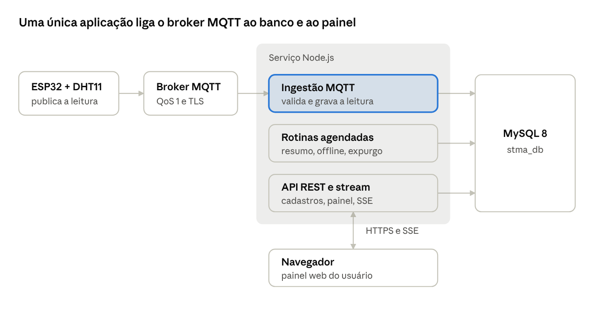

# Plano de implementação do backend: Monitoramento IoT (STMA)

12/10/2026 · Jorge Luiz dos Santos

> Revisão de execução: segue a instrução do proprietário de 12/10/2026.
> Schema confirmado: stma_schema.sql definitivo, 13 tabelas. Backend antes do
> frontend; sem ORM nesta versão. Evidências em ../roteiro-backend.md.
>
> **Fase 1 concluída:** base MVC, configuração local/Aiven, schema local e Aiven,
> health, lint, testes e CI aprovados. Evidência: commit ea1ea4c, tag backend-fase-1,
> execução GitHub Actions 38311559868. Fase 2 concluída: commit 7d664fe, tag backend-fase-2, CI 38314809772 aprovado. Fase 3 concluída: commit 28b071d, tag backend-fase-3, CI 38316891647 aprovado. Fase 4 em andamento: ingestão, adoção e testes locais implementados; decisões de timestamp e permissão confirmadas. Validação com HiveMQ/ESP32 pendente. Fases 5–7 não iniciadas.

## 1. Resumo

O backend é um único serviço Node.js que faz duas coisas sobre o banco `stma_db`: recebe a telemetria dos ESP32 pelo MQTT e serve a API REST do painel. Começa como um monólito modular, com ingestão e API no mesmo processo, e só se divide se o volume exigir. O plano tem sete fases, da base do projeto até a implantação, e cada uma termina com um critério de aceite verificável.

A base é o schema definitivo (`stma_schema.sql`) e o documento de requisitos (RF001 a RF017, RNF001 a RNF008, RN001 a RN007).

### 1.1 Stack proposta

| Camada | Escolha | Motivo |
| --- | --- | --- |
| Linguagem e runtime | TypeScript estrito, Node.js 22 | Mesma stack dos seus outros projetos |
| API | Express | Idem; simples e bem conhecido |
| Acesso ao banco | mysql2 com SQL parametrizado e repositórios por interface; Prisma somente em evolução futura | Instrução do proprietário em 12/10: não usar ORM; regras de negócio independem do driver |
| Validação | Zod | Valida entrada da API e payload MQTT com o mesmo mecanismo |
| Cliente MQTT | `mqtt` (mqtt.js) | Suporta QoS 1, TLS e reconexão automática |
| Senhas e sessão | argon2 e token aleatório com hash SHA-256 no banco | O schema já guarda só o hash do token (`sessao.token_hash`) |
| Agendamento | `node-cron` | Resumo por hora, offline e expurgo; roda no mesmo processo |
| Logs | pino | Log estruturado em JSON |
| Testes | Vitest e Supertest, MySQL real num contêiner | Os CHECK e as chaves compostas só se provam num MySQL de verdade |

### 1.2 Premissas

- O arquivo `stma_schema.sql` é a fonte da verdade. O schema é aplicado por SQL versionado; CHECK e chaves compostas são preservados. Uma adoção futura de Prisma deverá respeitar os contratos dos repositórios e essas restrições.
- Os tópicos MQTT seguem o firmware atual: `engeasier/<device_id>/...`. O `requisitos.md` (seção 9) prevê IDs da hierarquia no tópico; o schema e o firmware ficaram com o `device_id`, e o backend resolve o ambiente pelo banco.
- A conexão do banco abre com `SET time_zone = '+00:00'`. Todo horário é UTC; a conversão para America/Bahia é do frontend.
- Os pontos em aberto (superadmin, retenção de 90 dias, DHT11 ou DHT22) estão na seção 10.4 do documento do schema e não bloqueiam as fases 1 a 4.

## 2. Arquitetura

O serviço tem três módulos que compartilham o mesmo acesso ao banco: a ingestão, as rotinas e a API. O navegador nunca fala com o broker nem com o banco; a ingestão avisa a API quando grava uma leitura, e a API repassa pelo stream só à empresa dona do ambiente.



Cada módulo de negócio tem rotas, serviço e repositório, para que a regra (por exemplo, quando abrir um alerta) não dependa de Express nem de MQTT e possa ser testada sozinha.

```text
src/
  config/       variáveis de ambiente validadas com Zod
  db/           pool mysql2, UTC, TLS e scripts de SQL versionado
  modules/
    auth/       login, sessão, middleware de perfil
    cadastros/  empresas, unidades, setores, ambientes, usuários, dispositivos
    telemetria/ ingestão MQTT, leituras, alertas, série por hora
    stream/     SSE por empresa
    jobs/       resumo por hora, offline, expurgo, sessões
  shared/       erros, paginação, auditoria, log
  app.ts        monta o Express
  main.ts       sobe a API, o cliente MQTT e o agendador
tests/
```

## 3. Fases de implementação

As fases seguem a dependência dos requisitos: sem login não há escopo por empresa, sem cadastro não há dispositivo para a ingestão reconhecer. A ingestão (fase 4) pode andar em paralelo com a fase 3 depois que a tabela `dispositivo` existir.

| Fase | Entrega | Requisitos | Critério de aceite | Status |
| --- | --- | --- | --- | --- |
| 1. Base do projeto | Repositório TypeScript, Docker Compose com MySQL 8, `stma_schema.sql` aplicado, repositórios sem ORM e conexão local/Aiven por .env, configuração por variáveis de ambiente, lint, CI | RNF006, RNF008 | `GET /health` responde 200 e testa o banco; o CI roda os testes contra um MySQL real | [x] Concluída — local, Aiven e CI aprovados |
| 2. Autenticação e perfis | Login, logout, sessão por token, middleware que injeta `empresa_id` e perfil, guarda por perfil | RF001, RF015, RN001, RN007 | Senha errada dá 401; usuário da empresa A não lê nada da empresa B (teste automatizado); leitor não escreve | [x] Concluída — 26 testes locais e CI aprovados |
| 3. Cadastros | CRUD de empresa, unidade, setor, ambiente, usuário e dispositivo, com desativação lógica e auditoria | RF002 a RF007, RN002 a RN004 | Criar filho com pai de outra empresa é recusado pelo banco e pela API; `DELETE` só marca `ativo = 0` | [x] Concluída — 45 testes locais e CI aprovados |
| 4. Ingestão MQTT | Assinante dos tópicos, validação do payload, gravação idempotente, última leitura no dispositivo, fila de dispositivos pendentes | RF008, RF014, RNF005 | Leitura publicada aparece no banco; a mesma leitura reenviada não duplica; ID desconhecido vai para `dispositivo_pendente` | Em andamento — fluxo MQTT/MySQL e troca de broker testados localmente; HiveMQ/ESP32 pendente |
| 5. Leituras, painel e alertas | Endpoints do painel, histórico paginado, série por hora, CSV, alertas como episódios, reconhecimento de alerta | RF009 a RF013, RF016, RN005 | Histórico de 100.000 registros em menos de 3 s (RNF007); alerta abre ao sair da faixa e fecha ao voltar | Não iniciada |
| 6. Rotinas agendadas | Resumo por hora, marcação de offline, expurgo em lotes, limpeza de sessões expiradas | RF014, RN006 | Reexecutar o resumo da mesma hora não altera o resultado; o expurgo apaga em lotes e preserva os alertas | Não iniciada |
| 7. Implantação e demonstração | Deploy, TLS no MQTT, três usuários de banco, `stma_seed_demo.sql`, modo demonstração público, README | RF017, RNF002, RNF003, RNF008 | Leitura publicada no broker chega ao painel em até 5 s; um terceiro sobe o projeto seguindo o README | Não iniciada |

Cada fase fecha com seus testes passando e um commit etiquetado. A fase 5 só começa depois da 4, porque o alerta nasce na gravação da leitura.

## 4. API REST

A API tem prefixo `/api/v1`, fala JSON e identifica o usuário por um cookie `httpOnly`, `Secure` e `SameSite=Lax` que carrega o token de sessão. O servidor guarda só o SHA-256 do token. O `empresa_id` e o perfil vêm sempre da sessão, nunca do corpo da requisição ou da URL (RN001).

### 4.1 Perfis

| Perfil | Pode |
| --- | --- |
| superadmin | Cadastrar empresas e seus primeiros administradores; não pertence a empresa |
| administrador | Tudo dentro da própria empresa, inclusive cadastros e usuários (RN007) |
| operador | Ler tudo, reconhecer alertas e marcar dispositivo em manutenção |
| leitor | Somente ler painel, histórico, gráficos e alertas |

### 4.2 Rotas

| Rota | Perfil mínimo | Requisito |
| --- | --- | --- |
| `POST /auth/login`, `POST /auth/logout`, `GET /auth/me` | público, qualquer, qualquer | RF001 |
| `GET/POST/PATCH /empresas` | superadmin | RF002 |
| `GET/POST/PATCH /unidades`, `/setores`, `/ambientes` | leitor para ler, administrador para escrever | RF003 a RF005 |
| `GET/POST/PATCH /usuarios` | administrador | RF006 |
| `GET/POST/PATCH /dispositivos` | leitor para ler, administrador para escrever | RF007, RN006 |
| `GET /dispositivos-pendentes`, `POST /dispositivos-pendentes/:id/adotar` | superadmin | RF007 |
| `GET /painel` | leitor | RF009, RF010, RF014 |
| `GET /ambientes/:id/leituras?de&ate&pagina` | leitor | RF011 |
| `GET /ambientes/:id/serie?de&ate` | leitor | RF012 |
| `GET /ambientes/:id/leituras.csv?de&ate` | leitor | RF016 |
| `GET /alertas?situacao=aberto`, `POST /alertas/:id/reconhecer` | leitor para ler, operador para reconhecer | RF013 |
| `GET /stream` (Server-Sent Events) | leitor | RF009 |
| `GET /demo/painel` | público, somente empresa com `eh_demo = 1` | RF017 |

Os cadastros nunca têm `DELETE` real. A desativação é um `PATCH` com `ativo = false` (RN004), e as listagens escondem os inativos por padrão.

### 4.3 Convenções

- Erros no formato `{ "erro": { "codigo": "...", "mensagem": "...", "campos": [] } }`, com 400 para validação, 401 sem sessão, 403 sem perfil, 404 para recurso de outra empresa (não revela que existe) e 409 para duplicidade.
- Paginação por `pagina` e `tamanho`, com `tamanho` máximo de 500. O período de consulta tem limite máximo de dias; acima dele a API responde com a série por hora.
- Toda escrita de cadastro grava uma linha em `auditoria` com os valores antes e depois.
- Toda consulta de leitura junta `ambiente` para filtrar por `empresa_id`, como nas consultas da seção 10.1 do documento do schema.
- O `GET /stream` existe porque o `requisitos.md` prevê o painel assinando o broker direto por WebSocket, e num broker público qualquer pessoa assina `engeasier/#` e lê os dados de todas as empresas. Com o stream, o navegador nunca fala com o broker: o servidor recebe a leitura, grava e repassa só às sessões da empresa dona do ambiente. O stream envia um comentário de batimento a cada 25 s, para proxies não fecharem a conexão ociosa.

## 5. Ingestão MQTT e rotinas agendadas

O módulo de ingestão é o coração do sistema e o que mais precisa de teste. Ele assina `engeasier/+/dados`, `engeasier/+/porta` e `engeasier/+/status` com QoS 1, conecta ao broker por TLS (porta 8883) com client ID fixo e sessão persistente, para receber o que foi publicado enquanto o serviço estava fora. As credenciais vêm de variáveis de ambiente (RNF003).

### 5.1 Tratamento de uma mensagem

1. Extrair o `device_id` do tópico e validar com a mesma expressão do `CHECK` do banco (`^[a-z0-9_-]{3,64}$`).
2. Validar o payload com Zod: temperatura entre -50 e 100, umidade entre 0 e 100, hora opcional. Payload inválido é registrado no log e descartado, sem derrubar o serviço. O mapeamento campo a campo do firmware está na seção 9.3 do documento do schema.
3. Buscar o dispositivo ativo por `device_id`. Se não existir, fazer upsert em `dispositivo_pendente` (contador e último payload) e parar: a leitura não é gravada.
4. Definir `medido_em`: a hora do payload se existir e for plausível, senão a hora de recebimento. Enquanto o firmware não enviar NTP, vale sempre a hora de recebimento.
5. Gravar numa transação: a leitura (idempotente, `ON DUPLICATE KEY UPDATE id = id`) e a cópia da última leitura no dispositivo. O SQL está na seção 10.2 do documento do schema.
6. Aplicar a lógica de alerta (abrir, atualizar ou fechar o episódio) e, depois do commit, publicar o evento para o `GET /stream`.

Mensagens de `porta` gravam em `evento_porta` só quando o estado muda. Mensagens de `status` atualizam `status_conexao` e `ultimo_contato_em`; se o firmware configurar um último testamento (LWT) no tópico de status, o broker avisa a queda na hora e o dispositivo vira offline sem esperar o prazo.

### 5.2 Rotinas agendadas

| Rotina | Frequência | O que faz |
| --- | --- | --- |
| Resumo por hora | A cada hora, para a hora anterior; ao iniciar, recalcula as últimas 48 h | `INSERT ... ON DUPLICATE KEY UPDATE` em `leitura_hora`; reexecutar não muda o resultado |
| Marcação de offline | A cada minuto | Dispositivo online sem contato há mais de `offline_apos_seg` passa a offline (RF014) |
| Expurgo de leituras | Diária, de madrugada | Apaga em lotes de 10.000 as leituras com mais de 90 dias, só se o resumo por hora do período existir |
| Limpeza de sessões | Diária | Remove sessões expiradas ou revogadas há mais de 30 dias |

Se o serviço rodar em mais de uma instância, as rotinas passam a disputar um `GET_LOCK` do MySQL para que só uma execute, e a ingestão usa assinatura compartilhada (`$share`) para não gravar a mesma mensagem duas vezes.

## 6. Segurança, testes, implantação e riscos

### 6.1 Segurança

- Senhas com argon2; o token de sessão é aleatório, vai no cookie e só o SHA-256 dele fica no banco. Logout preenche `revogada_em`.
- Limite de tentativas no login (por IP e por e-mail) e mensagem de erro igual para e-mail inexistente e senha errada.
- Três usuários de banco: a API (SELECT, INSERT e UPDATE, e DELETE só em `sessao`), a manutenção (DELETE em `leitura_telemetria`) e um somente leitura para a demonstração.
- Todas as consultas parametrizadas; o Prisma e o SQL cru usam parâmetros, nunca concatenação.
- Segredos (banco, broker, chave do cookie) só em variáveis de ambiente; `.env` fora do Git e um `.env.example` sem valores reais (RNF003).
- O frontend chama `/api` no próprio domínio (rewrite da Vercel), então o cookie fica no mesmo site e não há CORS aberto; `helmet` ativo e corpo de requisição com tamanho máximo.
- O endpoint público de demonstração usa o usuário de banco somente leitura e só enxerga a empresa com `eh_demo = 1`.

### 6.2 Testes

| Nível | O que cobre | Como |
| --- | --- | --- |
| Unitário | Validação do payload, cálculo de severidade do alerta, escolha de `medido_em` | Vitest, sem banco |
| Integração com banco | Chaves compostas, CHECK, idempotência, resumo por hora, expurgo | Vitest contra MySQL 8 em contêiner, com o `stma_schema.sql` real |
| API | Autenticação, perfis e isolamento entre empresas (usuário A pedindo dado da B deve receber 404) | Supertest |
| Ingestão ponta a ponta | Publicar no broker de teste e ver a linha no banco; reenvio; ID desconhecido | Mosquitto em contêiner |
| Carga | Histórico de 100.000 leituras em menos de 3 s (RNF007) | Script que popula e mede |

### 6.3 Implantação

O ambiente de desenvolvimento sobe com Docker Compose (MySQL 8 e Mosquitto). Em produção, o serviço Node roda numa hospedagem simples (Railway, na sua stack) apontando para um MySQL 8.0.16 ou superior gerenciado. As migrações são arquivos SQL numerados aplicados em ordem, a partir do `stma_schema.sql`.

### 6.4 Riscos

| Risco | Efeito | Mitigação |
| --- | --- | --- |
| Broker público (HiveMQ) sem autenticação | Qualquer pessoa lê ou publica nos tópicos `engeasier/#` | Autenticar o backend e, para uso real, trocar por broker com usuário e TLS; tratar todo payload como não confiável |
| Firmware publica em QoS 0 (PubSubClient) | Perda de leituras sem aviso, contra o RNF005 | Trocar a biblioteca do firmware por uma com QoS 1 |
| Firmware sem hora (sem NTP) | `medido_em` vira hora de recebimento; reenvio atrasado fica com a hora errada | Adicionar NTP ao firmware |
| Intervalo de 2 s no firmware | Cerca de 1,8 GB por dispositivo por ano | Subir para 30 s (RN006) antes de ligar na nuvem |
| Duas instâncias do serviço | Rotinas e ingestão duplicadas | `GET_LOCK` e assinatura compartilhada, como na seção 5.2 |

## 7. Acompanhamento da execução — 12/10/2026

- [x] Base TypeScript/Express com controllers, serviços e repositórios por contrato.
- [x] Pool mysql2 sem ORM, UTC e consultas parametrizadas.
- [x] Alternância local/Aiven por backend/.env, TLS com CA no Aiven.
- [x] Schema definitivo aplicado no MySQL local e no serviço Aiven informado.
- [x] GET /health validado localmente e no Aiven; erro controlado quando indisponível.
- [x] Lint, typecheck, build, 6 testes HTTP/configuração e 3 testes de integração.
- [x] CI com MySQL real aprovado: https://github.com/jorgeluizdossantos/monitoramento-iot-temperatura-umidade/actions/runs/38311559868
- [x] Roteiro didático entregue em docs/roteiro-backend.md; commit ea1ea4c e tag backend-fase-1.

### Fase 2 — concluída

- [x] Login, consulta da sessão e logout em /api/v1/auth.
- [x] Senhas Argon2id; token aleatório no cookie e somente SHA-256 no banco.
- [x] Cookie HttpOnly/Secure/SameSite=Lax, expiração e revogação persistidas.
- [x] Escopo/perfil consultados no banco; guardas sem privilégio implícito para superadmin.
- [x] Limites de login por IP/e-mail e validação de origem/JSON.
- [x] Testes de 401/403/404, expiração, desativação, rotação e isolamento.
- [x] Lint, typecheck, build e 26 testes aprovados: 18 sem banco e 8 com MySQL real.
- [x] CI aprovado: https://github.com/jorgeluizdossantos/monitoramento-iot-temperatura-umidade/actions/runs/38314809772
- [x] Roteiro atualizado, commit 7d664fe e tag backend-fase-2.

Na entrega da Fase 2, o isolamento foi validado com rota exclusiva de teste.
A Fase 3, abaixo, acrescentou os cadastros reais com filtro obrigatório por
empresa e seus testes. A Fase 2 não criou usuários no Aiven nem carregou seed demo.

### Fase 3 — concluída

- [x] Cadastros de empresa, unidade, setor, ambiente, usuário e dispositivo.
- [x] Leitura/escrita com escopo e perfis; manutenção restrita para operador.
- [x] FKs compostas e validação de pai/ancestrais na API.
- [x] Paginação, exclusão lógica, reativação e validação de PATCH de faixas.
- [x] Auditoria atômica, sem senha/hash/token; rollback em falha.
- [x] Proteção concorrente do último administrador e revogação por troca de senha.
- [x] Empresa e primeiro administrador criados na mesma transação.
- [x] CLI de bootstrap; superadmin solicitado criado no MySQL local e Aiven.
- [x] Login/me/logout/revogação verificados nos dois bancos; TLS confirmado no Aiven.
- [x] Lint, typecheck, build e 45 testes locais aprovados (23 sem banco e 22 com MySQL).
- [x] Commit 28b071d e tag backend-fase-3; CI aprovado: https://github.com/jorgeluizdossantos/monitoramento-iot-temperatura-umidade/actions/runs/38316891647

Dispositivos pendentes/adoção pertencem à Fase 4. Não houve nova migração,
seed demo, endpoint de telemetria ou implementação de frontend nesta etapa.

**Falta:** Fases 4–7 do backend, incluindo ingestão,
leituras/alertas, rotinas e implantação. O frontend permanece não iniciado.
**Próximo passo após aceite:** Fase 4 — ingestão MQTT, validação, idempotência, persistência e configuração do broker. Esclarecer timestamps e adoção de dispositivos pendentes antes de implementar.
A publicação adicional em wxlv7h aguarda confirmação do destino/acesso.

## Acompanhamento da Fase 4 — 12/10/2026

- [x] Configuração independente do fornecedor e TLS validado na configuração.
- [x] Consumidor, validação, transação, deduplicação com timestamp e estado atual.
- [x] Fila global e adoção exclusiva por superadmin, conforme autorização do proprietário.
- [x] Testes locais com dois brokers, MySQL real, reconexão, reentrega e LWT.
- [x] Roteiro didático e comandos de diagnóstico/publicação.
- [ ] Confirmar modalidade do HiveMQ, host, porta e contrato do firmware real.
- [ ] Validar conexão externa e leitura física do ESP32 no banco escolhido.
- [ ] Aceite e tag de conclusão da Fase 4.

Sem timestamp válido, usar recebimento; não prometer deduplicação nesse caso. Próximo passo: seguir docs/roteiro-hivemq-fase4.md e concluir a validação física. Fases 5–7 permanecem não iniciadas.

Evidência: commit 4c668dc, 75 testes locais aprovados e CI remoto aprovado: https://github.com/jorgeluizdossantos/monitoramento-iot-temperatura-umidade/actions/runs/38320360868. Sem tag de encerramento enquanto a validação física estiver pendente.

### Atualização: broker Lab identificado e conexão validada

O proprietário confirmou HiveMQ Software, nome Lively Honey, pacote Lab. Foi encontrado o contêiner local hivemq em execução, publicando MQTT em 1883 e Control Center em 8080. O diagnóstico mqtt:check, com MQTT_URL=mqtt://127.0.0.1:1883 somente no ambiente do comando, conectou e obteve as três assinaturas QoS 1. TLS não foi usado porque a conexão foi loopback local. O arquivo .env não foi alterado e o diagnóstico não gravou telemetria.

A modalidade e o endpoint local estão confirmados. Ainda falta localizar o .ino efetivamente em uso, apontar ESP32 e backend ao mesmo broker e validar a leitura física no banco/ambiente escolhido. O ESP32 deve usar o IPv4 da máquina na mesma rede, porta 1883; localhost na placa apontaria para a própria placa. O computador e o Docker precisam permanecer ligados. Não foi criado serviço Cloud nem contratado plano.

### Firmware localizado e cópia preparada

O sketch atual mqtt_esp32_aula_pub foi lido no caminho indicado pelo proprietário. Ele gera o ID a partir do MAC e publica o JSON esperado em /dados; o comando de LED usa /comando. Foi criada a cópia firmware/mqtt_esp32_stma, preservando pinos, mensagens e comportamento. Wi-Fi e host/porta foram separados em config.h ignorado pelo Git, com modelo público config.example.h. Host local observado: 192.168.0.102:1883 para a placa; backend no mesmo PC usa 127.0.0.1:1883.

O original foi preservado. Sem compilador arduino-cli disponível no PATH, não foi confirmada compilação desta cópia. Faltam selecionar placa/COM, verificar e carregar pela Arduino IDE, conferir mensagens no HiveMQ local e validar adoção/persistência no banco escolhido. Fase 4 continua aberta. Instruções em firmware/mqtt_esp32_stma/README.md.

### Compilação física — ESP32 Dev Module / COM13

O proprietário confirmou ESP32 Dev Module, COM13, USB e mesma rede Wi-Fi. Autorizou MySQL local e hierarquia Laboratório STMA → Bancada → Testes → Bancada ESP32, com DHT11.

Foi localizado o arduino-cli incluído na Arduino IDE. A compilação com esp32:esp32:esp32 e as bibliotecas Arduino locais foi aprovada: 902380 bytes de programa (68%) e 47328 bytes de RAM (14%). A tentativa de upload falhou ao abrir COM13, com acesso negado/porta ocupada ou indisponível; não houve confirmação de gravação. Solicitado fechar Monitor Serial/Plotter e outros clientes seriais antes de tentar novamente.

Próximo passo: liberar COM13, repetir upload e validar mensagens reais no HiveMQ local; somente depois provisionar a hierarquia autorizada e confirmar a persistência. Nenhum cadastro demonstrativo ou leitura física foi criado nesta tentativa. Fase 4 permanece aberta.
